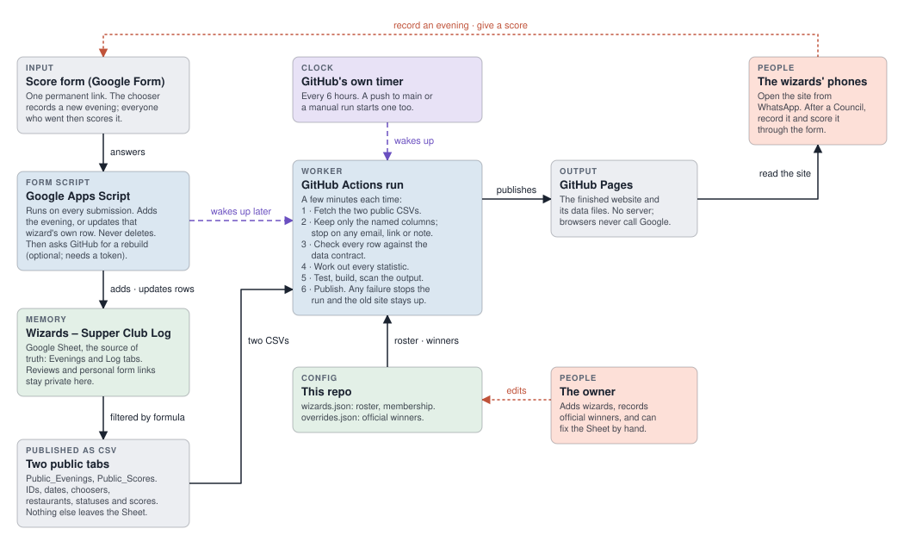

# Wizards Supper Club

A public, read-only website that turns the Wizards' Google Sheet into a record of every supper club evening: scores, circuit winners, trends, records, and who is still to host this circuit.

The Sheet stays the single source of truth. GitHub Actions fetches two purpose-built public tabs, checks them, works out every statistic and publishes a static site to GitHub Pages. The browser never calls Google, so the site keeps working if the Sheet is unavailable.

Live site: <https://mjnelson18.github.io/wizards-supper-club/>

## How it fits together

<picture>
  <source media="(prefers-color-scheme: dark)" srcset="docs/architecture-wizards-dark.svg">
  
</picture>

Boxes are roles: a **clock** that decides when to run, **workers** (the form script and the GitHub
Actions computer) that run for a moment and stop, **outside services** read from or published to,
**memory** between runs, and **people**. Dashed arrows are wake-up calls carrying no data; solid
arrows move data; dotted arrows are things only a person does. There is no AI step.

Scores go in through one Google Form. A script behind it writes each answer into the Sheet, which
holds everything, including reviews that are never published. Only two filtered tabs leave the Sheet,
as CSV. The GitHub Actions run fetches those, refuses anything that looks like an email, a link or
free text, works out every statistic and publishes finished files. The site has no server: visitors
download those files, so it keeps working if the Sheet is unavailable, and a failed run leaves the
previous version live.

## Owner setup (one-off)

### 1. In the Sheet

1. Add a tab **Public_Evenings** with this in A1:
   `=QUERY(Evenings!A:H,"select A,B,C,D,E,F,H where A is not null",1)`
   (column H is Cuisine, which the score form fills in; column G, the average, is left out)
2. Add a tab **Public_Scores** with this in A1:
   `=QUERY(Log!A:D,"select A,B,C,D where A is not null and C <> 'Note'",1)`
3. Optional: add a tab **Public_Status** with a header row `key`, `value` and rows `baton_holder`, `next_date` (as `YYYY-MM-DD`), `next_restaurant`, filled in by hand.
4. File → Share → Publish to web → choose each public tab separately → **Comma-separated values (.csv)** → Publish. Keep the three links.

Dates in the Date column must display as `YYYY-MM-DD` (Format → Number → Custom date and time). Blank dates are fine.

Never publish the Log, Form Responses or Links tabs. The site only ever needs the public tabs above.

### 2. In the GitHub repo

1. Settings → Secrets and variables → Actions → **Variables** tab → add `EVENINGS_CSV_URL`, `SCORES_CSV_URL` and (optional) `STATUS_CSV_URL` with the links from step 4.
2. Settings → Pages → Build and deployment → Source: **GitHub Actions**.
3. Actions → **Build and deploy** → Run workflow. The site address appears on the finished run and under Settings → Pages.

After that the site rebuilds on every push to `main`, every 6 hours, and whenever you press Run workflow. If the Sheet cannot be fetched or fails a check, the run fails, nothing is published and the previous version stays live. The failed run's log lists every problem with its row number.

GitHub pauses scheduled runs in a repo with no activity for 60 days and emails you first. Pressing Run workflow, or any push, starts them again.

## How to add a wizard

1. Add their rows to the Sheet as usual, using one consistent name in the Wizard and Chooser columns.
2. Edit [config/wizards.json](config/wizards.json) and add an entry:

   ```json
   { "sheetName": "Jonathan", "displayName": "Jonny", "fullName": "Jonathan Hine", "memberFrom": 5, "memberUntil": null }
   ```

   - `sheetName`: the name exactly as it appears in the Sheet.
   - `displayName`: what the site shows.
   - `memberFrom`: their first circuit. `memberUntil`: their last circuit, or `null` while they are a member.
3. Add them to `SF_WIZARDS` at the top of the score form script in Apps Script (and in [apps-script/ScoreForm.gs](apps-script/ScoreForm.gs)), then run `refreshScoreForm` there so they appear in the form. A unit test fails if the two rosters drift apart.
4. Commit to `main`. The site rebuilds.

When someone leaves, set `memberUntil` to their last circuit. They stop being "due" and their attendance is only counted for the circuits they were in.

A name in the Sheet that is not in `wizards.json` (a guest, a typo) fails the build on purpose, so guests never appear on the site.

## How to record an official winner

The site works out each circuit's winner as the chooser of the highest evening average among evenings with 3 or more scores. A circuit stays **provisional** while any of its evenings has a TBC or UNK status, or while a current member has yet to host in it.

To record a result the group has declared, edit [config/overrides.json](config/overrides.json):

```json
{
  "C6": { "winner": "Jeremy", "announced": "2024-08-16" },
  "C7": { "winner": "Thomas", "evening": "C7-06", "announced": "2026-12-01" },
  "C3": { "final": true }
}
```

- `winner`: sheet name or display name. The circuit is shown as Official and is no longer provisional.
- `evening`: only needed when the winner hosted more than one evening in that circuit.
- `announced`: optional date. The home page shows a finished circuit's winner for 60 days after it.
- `final`: marks a circuit as finished and keeps the calculated winner. Use it for old circuits that would otherwise stay provisional because of unknown attendance.

## Cuisines

The Cuisines page (linked from Restaurants and Trends) shows the most and least visited cuisines, how the mix has changed circuit by circuit, what each wizard tends to pick, and what each tends to rate above or below the rest of the table.

Nothing calls an AI model when the site builds. A cuisine comes from one of two places:

- **The Sheet's Cuisine column** (Evenings, column H). The score form asks the chooser "What kind of food was it?" and fills this in. To correct one, edit the cell.
- **[config/cuisines.json](config/cuisines.json)**, for evenings with nothing in that column. All the history before the form asked the question is here, classified once by hand.

The Sheet wins when both have a value. `config/cuisines.json` also holds the list of cuisines and the part of the world each belongs to (`regions`); the form offers the same list.

If a chooser types a cuisine that is not on the list, the site files it under "Elsewhere" and the build logs a warning. Add it to `regions` (and to `SF_CUISINES` in the form script) to place it properly.

To classify an evening by hand instead, add one line under `evenings`:

```json
"C8-02": { "restaurant": "The Palomar", "cuisine": "Israeli" }
```

- `cuisine` must be one of the names under `regions`. To use a new cuisine, add it there first with the part of the world it belongs to, e.g. `"Korean": "East Asia"`.
- `restaurant` is only a label so the file is readable. The build warns if it no longer matches the Sheet.
- An evening with no cuisine in either place is not an error. The build logs a warning, the evening shows under "Not yet classified", and it is left out of the cuisine figures until you add it.

## Scoring future evenings

[apps-script/ScoreForm.gs](apps-script/ScoreForm.gs) creates one permanent Google Form that is reused for every evening. It writes into the same Evenings and Log tabs as the catch-up form, so the site picks the results up with no further setup.

After each Council:

1. **The chooser** opens the form, picks "Record a new evening" and gives the restaurant, the kind of food, date, circuit and who was there. That adds the evening to the Evenings tab, with its cuisine, and a Log row per wizard: TBC (score owed) for those there, DNA for the rest.
2. **Everyone who went** opens the same link, picks "Score an evening", chooses the evening and gives a score from 0 to 10. They can also say they were not there, or ask for the evening's average. Submitting again corrects an earlier answer.

Reviews typed into the form stay in the Log tab's private "Review / note" column, which is never published.

### Setting it up (once, at a computer)

1. Open <https://script.google.com> and open the project that holds the catch-up form script.
2. Press + next to Files → Script, name it `ScoreForm`, paste in the whole of `apps-script/ScoreForm.gs` and save.
3. Choose `setupScoreForm` in the function dropdown and press Run, then allow the permissions.
4. The execution log shows the form's share link. Pin it in WhatsApp.

Take a copy of the Sheet first (File → Make a copy) the first time you use it. The script only ever updates a wizard's own row or adds rows, and its sheet-writing logic is unit-tested here against a fake Sheet, but it has not been run inside Google by these tests.

### Upgrading a form made before the cuisine question

1. In the Apps Script project, open `ScoreForm.gs`, select everything, paste the current `apps-script/ScoreForm.gs` over it and save.
2. Choose `upgradeScoreForm` in the function dropdown and press Run.

It adds a Cuisine column (H) to the Evenings tab, changes the Public_Evenings formula to publish it, and adds the question to the existing form. The form's link does not change, and running it twice does no harm. If Public_Evenings does not hold the formula it expects, it leaves the tab alone and the log tells you what to set.

### Near-instant updates (optional)

Without this, new scores reach the site at the next 6-hourly rebuild.

1. On GitHub: Settings → Developer settings → Personal access tokens → Fine-grained tokens → generate one limited to this repo with **Contents: Read and write**.
2. In the Apps Script project: Project Settings → Script properties → add `GITHUB_TOKEN` with that token.

The script then asks for one rebuild about 7 minutes after a submission. The wait is deliberate: Google's published CSV lags the Sheet by a few minutes.

## Privacy

- The fetch script keeps only named columns (Evening ID, Circuit, No. in circuit, Date, Chooser, Restaurant, Cuisine; Evening ID, Wizard, Status, Score) and drops everything else, even if extra columns appear in the CSV.
- The build fails if any kept cell contains `@`, `http` or `docs.google.com`, or is longer than 60 characters (restaurant names: 80).
- After the build, `npm run check:dist` scans the output for email addresses, Google Forms and Sheets links, and the `Review` header, and blocks the deploy on a hit.
- `public/data/` is generated in CI and is not committed.

## Working on it locally

Needs Node 24.

```sh
npm install
npm run data:sample   # made-up data, clearly labelled on the site
npm run dev
```

To use the real Sheet locally, set the three variables in your shell and run `npm run data`. Each can be a link or a path to a saved CSV file.

| Command | What it does |
| --- | --- |
| `npm run data` | Fetch, whitelist, validate and compute from the real Sheet |
| `npm run data:sample` | The same pipeline over made-up data |
| `npm test` | Unit tests for the statistics and the data checks |
| `npm run test:known` | Acceptance check against the known values (below) |
| `npm run build` | Type-check and build to `dist/` |
| `npm run check:dist` | Privacy scan of `dist/` |
| `npm run test:e2e` | Browser smoke test at 360 px, with accessibility checks (run `npx playwright install chromium` once first) |

### Known values

`npm run data && npm run test:known` checks the real data against the figures in the build spec (60 evenings, 324 scores, Ivan Mazemen 8.92, and so on) as the Sheet stood on 18 Nov 2026. It is a one-off acceptance check and not part of the deploy: those figures are a snapshot and will change as missing scores are filled in.

## Layout

```
config/wizards.json         roster, display names, membership periods
config/overrides.json       official winners
config/cuisines.json        each evening's cuisine, and the region each cuisine sits in
scripts/fetch-data.ts       fetch, whitelist, validate, compute
scripts/sample-data.ts      made-up data for local work
scripts/check-dist.mjs      privacy scan of the built site
src/lib/stats.ts            every metric (pure functions)
src/lib/ingest.ts           CSV parsing, privacy guards, data contract
src/lib/*.test.ts           unit tests
src/pages/                  Home, Circuits, Restaurants, Wizards, Trends, Records, Methods
tests/smoke.spec.ts         browser smoke test
apps-script/ScoreForm.gs    the reusable score form (runs in Google Apps Script)
public/data/                generated JSON (gitignored; built in CI)
.github/workflows/deploy.yml
```

The Methods page on the site explains each metric in plain words.
